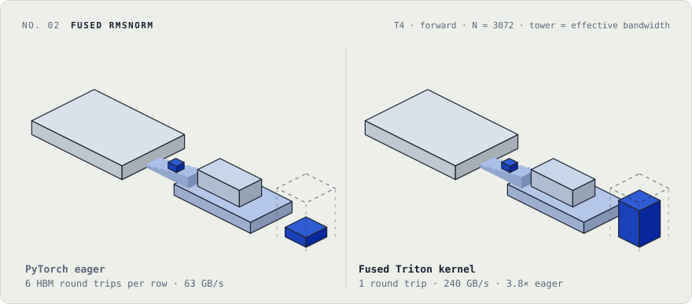

### Aryan Ashta

Math + CS at UIUC. I build ML systems from the bottom up: compilers for microcontrollers, GPU kernels, and methods for adapting language models.

<a href="https://www.aryanashta.me/work/ttc">
  <picture>
    <source media="(prefers-color-scheme: dark)" srcset="assets/ttc-dark.svg">
    
  </picture>
</a>

**[ttc](https://github.com/Aryan-Ashta/ttc)** compiles a PyTorch CNN to C for the RP2040, packs its activations into 208 bytes of SRAM, and verifies parts of the kernel with Z3.

<a href="https://www.aryanashta.me/work/rmsnorm">
  <picture>
    <source media="(prefers-color-scheme: dark)" srcset="assets/rmsnorm-dark.svg">
    
  </picture>
</a>

**[fused-RMSNorm](https://github.com/Aryan-Ashta/fused-RMSNorm)** is a Triton kernel that keeps the whole reduction on chip: 240 GB/s effective bandwidth on a T4, 3.8× PyTorch eager.

<a href="https://www.aryanashta.me/work/debt-cascades">
  <picture>
    <source media="(prefers-color-scheme: dark)" srcset="assets/debt-cascades-dark.svg">
    
  </picture>
</a>

**[Gambling debt cascades](https://github.com/Aryan-Ashta/Mathworks-Math-Modeling-Challenge-2026-Problem-3)** models how gambling losses cascade into bankruptcy as a nine-state Markov chain (M3 Challenge 2026).

Also: [Hierarchical Adapter Fusion](https://github.com/Aryan-Ashta/Hierarchical_Adapter_Fusion) · [mappr](https://github.com/Aryan-Ashta/mappr) (interactive codebase maps for oh-my-pi agents)

[aryanashta.me](https://www.aryanashta.me) · [LinkedIn](https://www.linkedin.com/in/aryan-ashta) · [X](https://x.com/aryanashta) · [CV](https://www.aryanashta.me/cv.pdf)
